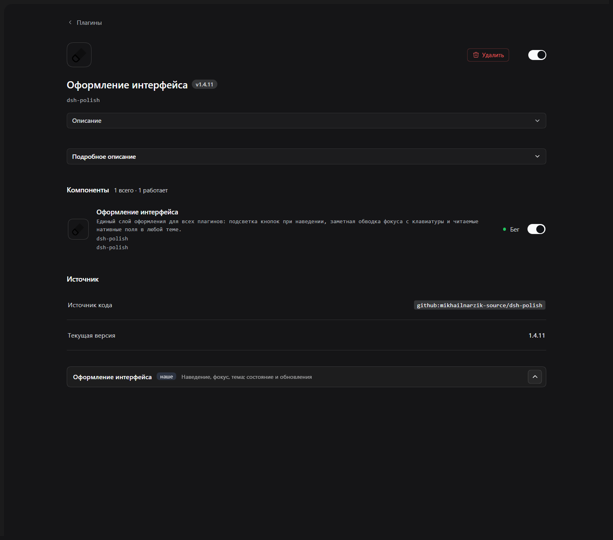

# dsh-polish

Единый слой оформления для всех плагинов DeepSeek Harness плюс одна страница, где
видно состояние окружения и доступные обновления.



*Страница плагина в интерфейсе DSH.*

## Что это и зачем

DSH — приложение, в котором вы разговариваете с ассистентом. Плагины рисуют в нём
свои кнопки, поля и списки, и каждый делает это по-своему: где-то кнопка при
наведении не подсвечивается, где-то не видно, на чём стоит клавиатурный фокус.

`dsh-polish` добавляет один общий слой стилей поверх приложения, не трогая чужие
плагины изнутри:

- подсвечивает кнопки при наведении (hover) и при нажатии;
- рисует заметную синюю обводку там, где фокус с клавиатуры, — удобно без мыши;
- держит нативные поля `input`, `select`, `textarea` в цветах текущей темы;
- делает полосы прокрутки спокойнее;
- сворачивает описание и «Подробное описание» на странице каждого плагина, чтобы
  список плагинов не был простынёй.

Кроме оформления плагин даёт рабочий экран:

- «Состояние» — десять проверок окружения в одном месте: Node.js, git,
  синхронизация сессий, резерв, токен GitHub, Chrome, порт отладки, секреты
  браузера, MCP-сервер Playwright, версии плагинов. Для двух проблем есть кнопка
  «Исправить».
- «Журнал» — что проверяли и исправляли в последнее время.
- «Обновления плагинов» — сравнение установленных версий с GitHub и обновление
  командой CLI.
- кнопка «↻ Обновить» в боковой панели — перезагрузить окно, если интерфейс завис.

Всё это необязательно: оформление можно выключить одним флажком, остальное
продолжит работать.

## Как открыть

1. Левая панель → «Плагины».
2. Карточка «Оформление интерфейса» (пакет `dsh-polish`) → страница плагина.
3. Раздел «Оформление интерфейса» — свёрнутая строка с бейджем «наше». Нажмите на
   неё или на шеврон справа.

Внутри по порядку: «Состояние», «Журнал», «Обновления плагинов», в самом низу —
флажок «Подсветка наведения и фокус».

Кнопка «↻ Обновить» живёт в боковой панели (внизу) и работает на любой странице.

## Как пользоваться пошагово

**Включить или выключить оформление.**

1. Откройте раздел плагина.
2. Снимите или поставьте флажок «Подсветка наведения и фокус».
3. Ожидаемый результат: рядом появится «Включено» / «Выключено», а подсветка
   кнопок и обводка фокуса меняются сразу, без перезагрузки. Выбор запоминается в
   браузере и действует, пока вы не поменяете его снова.

**Проверить состояние окружения.**

1. В блоке «Состояние» нажмите «Проверить». Кнопка на время станет «Проверяю…».
2. Ожидаемый результат: список из десяти строк. Слева ✓ зелёный или ✗ красный,
   дальше название, подробность и подсказка, что делать.
3. Счётчик «Быстрый старт: N из 5» показывает, сколько из пяти базовых шагов
   готово (синхронизация, резерв, порт, токен, версии).
4. Там, где есть кнопка «Исправить» (MCP-сервер и секреты браузера), нажмите её.
   Ожидаемый результат: сообщение «сервер добавлен, перезапусти DSH» или
   «шаблон создан: browser-secrets.env», список проверок обновится сам.

**Посмотреть журнал.**

1. В блоке «Журнал» нажмите «Показать».
2. Ожидаемый результат: до восьми последних записей — время, плагин, вид записи и
   текст. Если записей нет, будет «Записей пока нет».

**Проверить и поставить обновления.**

1. В блоке «Обновления плагинов» нажмите «Проверить».
2. Ожидаемый результат: строки «имя, установленная версия → версия на GitHub».
   Если всё свежее — «все актуальны».
3. Если есть отставшие: «Скопировать команды» положит в буфер команды
   `dsh plugin … add` для них, а «Обновить всё» переустановит отставшие плагины
   сам (сначала `remove`, затем `add`).
4. После любого обновления перезапустите DSH — новая версия подхватится при
   старте.

**Свернуть описание на странице плагина.**

1. Откройте страницу любого плагина.
2. Строка «Описание» с шевроном справа — клик разворачивает и сворачивает.
   Строка «Подробное описание» (README/DETAIL) ведёт себя так же.
3. Ожидаемый результат: состояние запоминается отдельно для каждого плагина.

**Перезагрузить окно.**

1. Нажмите «↻ Обновить» в боковой панели или Ctrl+R / F5.
2. Ожидаемый результат: страница перезагружается, несохранённых данных в DSH нет.

## Примеры

**Команда ассистенту.** Плагин регистрирует инструмент `app_reload`:

> Перезагрузи окно приложения — интерфейс завис.

Ассистент вызовет инструмент; ответ будет `{"ok":true,"windows":1}`, окно
обновится. Если окна не найдены — `{"ok":false,"message":"окна приложения не
найдены"}`.

**Команды обновления вручную.** Кнопка «Скопировать команды» копирует только
команды установки (`add`). Если ставите поверх вручную, сначала удалите старую
версию:

```powershell
& "$env:LOCALAPPDATA\Programs\DeepSeek Harness\resources\runtime\cli\bin\dsh.cmd" `
  plugin --profile desktop remove dsh-cards
& "$env:LOCALAPPDATA\Programs\DeepSeek Harness\resources\runtime\cli\bin\dsh.cmd" `
  plugin --profile desktop add github:mikhailnarzik-source/dsh-cards
```

Отставшие плагины обрабатываются парами команд: сначала `remove`, потом `add`.

**Выключить автообновление.** Плагин сам проверяет версии через 90 секунд после
старта и потом раз в 6 часов. Чтобы фоновая установка не запускалась, задайте
переменную окружения `DSH_AUTO_UPDATE=off` и перезапустите DSH.

**Проверить порт браузера вручную.**

```powershell
Test-NetConnection 127.0.0.1 -Port 9222
```

`TcpTestSucceeded : True` — браузер агента поднят.

## Что вы увидите

| Элемент | Как выглядит |
|---|---|
| Заголовок | «Внешний вид всех плагинов» |
| Подсказка | одна строка о том, что плагин делает |
| «Состояние» | заголовок, кнопка «Проверить», счётчик «Быстрый старт: N из 5» |
| Строка проверки | ✓/✗, название, подробность, подсказка, иногда «Исправить» |
| «Журнал» | заголовок, кнопка «Показать», записи время — плагин — вид — текст |
| «Обновления плагинов» | «Проверить», «все актуальны» / «доступно: N», «Скопировать команды», «Обновить всё» |
| Строка версии | имя, установленная версия, стрелка →, версия на GitHub (жирная, если отстаёт) |
| Флажок | «Подсветка наведения и фокус» + «Включено» / «Выключено» |
| Боковая панель | кнопка «↻ Обновить» |
| Страница плагина | строки «Описание» и «Подробное описание» с шевронами |

## Частые ошибки и что делать

| Симптом | Причина | Что делать |
|---|---|---|
| «✗ Токен GitHub: не задан» | токен не сохранён в DSH | Настройки → Плагины → GitHub → Personal access token |
| «✗ Порт отладки 9222» | браузер агента не запущен | «Старт» справа → «Запустить браузер» |
| «✗ Chrome: не найден» | Chrome не установлен | Установите Google Chrome |
| «✗ MCP-сервер Playwright» | сервер не прописан в профиле | «Исправить», затем перезапуск DSH |
| «✗ Секреты браузера» | нет файла `browser-secrets.env` или он пуст | «Исправить», затем впишите логины в файл |
| «✗ Версии плагинов: отстают …» | установлены старые версии | «Скопировать команды» или «Обновить всё» |
| «✗ Резерв» | последняя выгрузка не удалась | Проверьте место на диске и запустите синхронизацию |
| «✗ Репозиторий сессий: нет доступа» | не выполнен вход в GitHub | `git ls-remote <адрес>` и вход в GitHub |
| «CLI DeepSeek Harness не найден» | нестандартная установка приложения | Выполните команды из «Скопировать команды» вручную |
| Описания не сворачиваются | страница собрана до загрузки плагина | Обновите страницу кнопкой «↻» |
| Ctrl+R не срабатывает | клавишу перехватило другое окно | Нажмите «↻ Обновить» |

## Ограничения и безопасность

- Плагин не меняет поведение и настройки других плагинов. Единственная правка
  разметки — строка-переключатель у описания на странице плагина.
- Цвета не переопределяются: только яркость, обводка фокуса и `color-scheme`.
  Поэтому подсветка работает и в сторонних плагинах, даже если они задают свои
  цвета инлайново.
- Проверки только читают. Они смотрят `~/.dsh/dsh-sync.json`,
  `~/.dsh/dsh-sync/*.json`, `~/.dsh/browser-secrets.env`, файл профиля, версии
  установленных пакетов и слушают порт 9222. Никуда эти данные не отправляются.
- «Исправить» для MCP дописывает сервер Playwright в `cordis.patch.yml` профиля и
  предварительно делает резервную копию `.bak-mcp-<время>`.
- «Исправить» для секретов создаёт шаблон `browser-secrets.env`, если файла нет.
  Существующий файл не перезаписывается.
- Сеть используется только чтобы прочитать версию с
  `https://raw.githubusercontent.com/.../package.json` и затем установить плагин
  через CLI с GitHub.
- Автообновление меняет установленные плагины без отдельного вопроса: раз в 6
  часов отставшие переустанавливаются. Отключается переменной
  `DSH_AUTO_UPDATE=off`.
- Переключатель оформления хранится в браузере (`localStorage`,
  `dsh-polish:enabled`), а не в профиле. Сброс данных браузера вернёт его к
  включённому состоянию.
- Проверки Chrome, порта 9222 и браузерных секретов рассчитаны на Windows.

## Связанные плагины

- `dsh-sync` — синхронизация и резерв; плагин показывает их состояние.
- `dsh-github-safe` — GitHub-токен; проверка «Токен GitHub» относится к нему.
- `dsh-browser-launcher` — запуск Chrome с портом 9222; на него ссылается
  подсказка про порт.
- `dsh-sessions` — история сессий; даёт данные для проверок синхронизации.
- `dsh-cards`, `dsh-review` — их карточки на странице плагина оформляются тем же
  слоем.
- `dsh-vault` — секреты; файл `browser-secrets.env` относится к браузерным
  логинам, а не к сейфу.

## Установка

```powershell
& "$env:LOCALAPPDATA\Programs\DeepSeek Harness\resources\runtime\cli\bin\dsh.cmd" `
  plugin --profile desktop add github:mikhailnarzik-source/dsh-polish
```

После установки перезапустите DSH.

## Проверка

```powershell
node test/smoke.mjs
```

Смоук-тест загружает `client.js` в минимальном фейковом DOM и проверяет
регистрацию, оформление, переключатель и сворачивание описаний.
