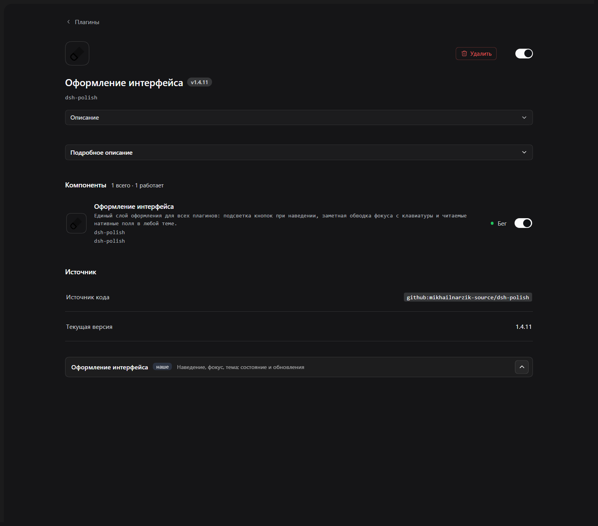
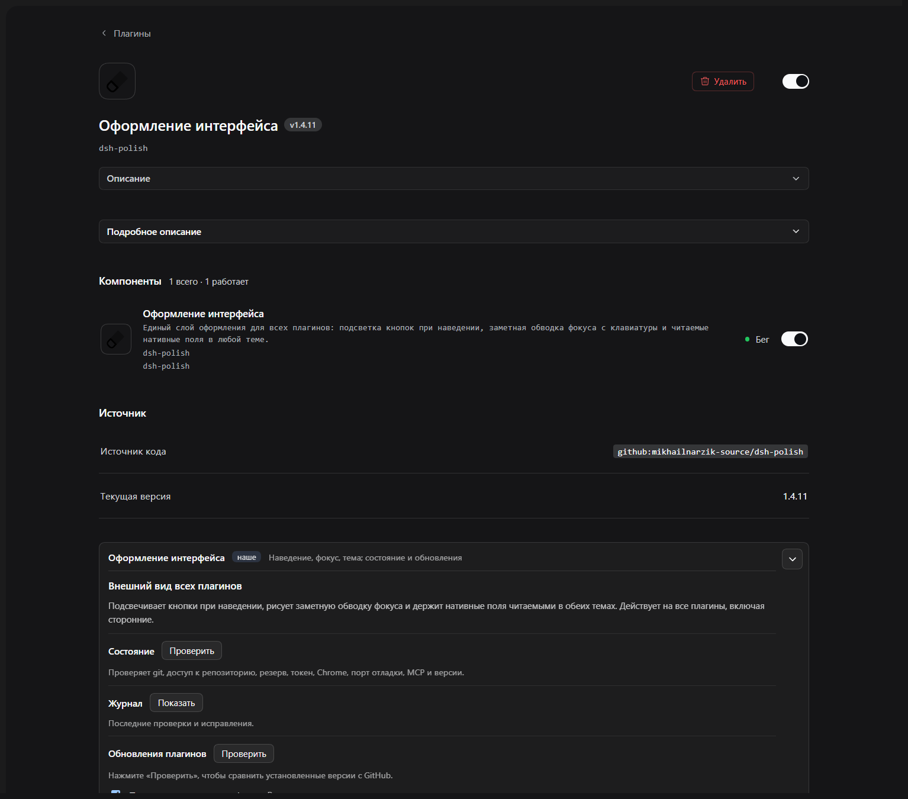

# dsh-polish — подробное описание

Плагин делает три вещи: добавляет общий слой оформления поверх интерфейса DSH,
показывает на своей странице состояние окружения, журнал и доступные обновления
плагинов, а также добавляет в левую панель одиннадцать панелей-ярлыков, чтобы
закрепить в ней можно было любой наш плагин, а не только откреплённый ранее.

## Что это и зачем

| Термин | Что это |
|---|---|
| DSH | DeepSeek Harness — приложение с ассистентом |
| Плагин | дополнение, которое добавляет в DSH кнопки, страницы и инструменты |
| hover | состояние «мышь наведена на элемент» |
| focus-visible | состояние «элемент выбран клавиатурой»; обычно невидимо без стилей |
| Нативное поле | стандартный `input`, `select` или `textarea` браузера |
| Тема | светлое или тёмное оформление приложения |
| MCP | способ подключить к ассистенту внешний сервер, здесь — Playwright для браузера |
| localStorage | маленькое хранилище в браузере; переживает перезагрузку страницы |
| CLI | командная строка DSH (`dsh.cmd`), которой ставят плагины |

Зачем: плагины в DSH сторонние, у каждого свои цвета и классы. Переопределять их
стили опасно — сломается при обновлении. Поэтому слой построен на свойствах,
которые накладываются поверх любой вёрстки: `filter: brightness()`, `outline`,
`color-scheme`, `scrollbar-color`. Ховер работает, даже если кнопка покрашена
инлайновым стилем.

Второй смысл плагина — диагностика: десять проверок отвечают на вопрос «почему не
работает браузер агента / синхронизация / GitHub», а кнопки «Исправить» убирают две
самые частые причины.

Третья часть — типографика и навигация. Длинные абзацы чата и страниц плагинов
выравниваются по ширине (`text-align: justify`, `hyphens: auto`,
`text-justify: inter-word`), при этом блоки кода, таблицы и пункты списков остаются
как были. На странице плагина есть блок-подсказка «Панели в левом меню», а в меню
«Ещё» левой панели — список «Откреплённые панели» с кнопкой «Закрепить» у каждой
и кнопка «Закрепить все панели (N)».

Четвёртая часть — панели-ярлыки. DSH умеет закреплять в левой панели только то,
у чего есть панель: слот `main` и строка `sidebar.panellist` с одним и тем же
идентификатором. У большинства наших плагинов своей панели нет, поэтому
`dsh-polish` регистрирует одиннадцать пар «панель-ярлык + строка»: «Карточки»,
«Сжатие диалога», «Ревью изменений», «Уведомления», «Команда», «Сейф»,
«Pyrus: мои задачи», «Входящие», «Оформление интерфейса», «Кит-помощник»,
«Запуск браузера». Ключ и id каждой пары — `plugin-<id>`. Внутри ярлыка —
центрированная страница с описанием плагина и кнопкой «Открыть настройки
плагина».

## Как открыть

1. Левая панель → «Плагины».
2. Карточка «Оформление интерфейса» (пакет `dsh-polish`) → страница плагина.
3. Раздел «Оформление интерфейса» — свёрнутая строка с бейджем «наше» и подписью
   «Наведение, фокус, тема; состояние и обновления». Клик или шеврон раскрывает.
4. В блоке на странице: флажок «Подсветка наведения и фокус», «Панели в левом
   меню», «Состояние», «Журнал», «Обновления плагинов».
5. Панель-ярлык: строка с эмодзи в левой панели (например, 🧩 «Карточки») →
   страница с описанием и кнопкой «Открыть настройки плагина».
6. Кнопка «↻ Обновить» — внизу боковой панели, на любой странице.

## Как пользоваться пошагово

**Оформление.**

1. Раскройте раздел плагина.
2. Флажок «Подсветка наведения и фокус»: снимите — рядом появится «Выключено»,
   тег `<style>` исчезнет из `document.head`, стили снимутся сразу.
3. Поставьте обратно — «Включено», стили вернутся.
4. Ожидаемый результат: наведение на кнопки меняет яркость, а Tab показывает
   синюю обводку.

**Состояние.**

1. Нажмите «Проверить» в блоке «Состояние».
2. Пока идёт проверка — «Проверяю…», кнопка неактивна.
3. Ожидаемый результат: десять строк с ✓ или ✗ и счётчик «Быстрый старт: N из 5»
   (синхронизация, резерв, порт, токен, версии).
4. У проблемных строк есть подсказка; у MCP и секретов — кнопка «Исправить».
   Нажмите: «исправляю…», затем сообщение и повторная проверка.
5. Если проверка целиком не удалась — вместо списка будет ошибка, а не вечное
   «Проверяю…».

**Журнал.**

1. Нажмите «Показать».
2. Ожидаемый результат: до восьми записей. Формат: время (ЧЧ:ММ), плагин, вид
   (`health`, `fix`, `update`, `update-available`, `update-all`, `auto-update`),
   текст.
3. Записи пишутся автоматически при проверках, исправлениях и обновлениях.

**Обновления.**

1. Нажмите «Проверить» в блоке «Обновления плагинов».
2. Ожидаемый результат: строки `dsh-cards 1.7.7 → 1.7.7`, отставшие выделены
   жирным, сводка «все актуальны» или «доступно: N».
3. «Скопировать команды» — в буфере команды `dsh plugin … add` для отставших.
4. «Обновить всё» — плагин сам вызывает CLI: сначала `remove`, затем `add` для
   каждого отставшего. Ожидаемый результат: «обновлено: … — перезапусти DSH».
   Если CLI не найден — «CLI DeepSeek Harness не найден — выполни команды вручную».

**Сворачиваемые описания.**

1. Откройте страницу любого плагина.
2. Перед коротким описанием стоит строка «Описание» с шевроном; перед
   подробным — «Подробное описание».
3. Клик, Enter или пробел разворачивают блок, шеврон поворачивается на 180°.
4. Ожидаемый результат: оба блока по умолчанию свёрнуты; открытое состояние
   запоминается для каждого плагина отдельно.

**Перезагрузка окна.**

1. Кнопка «↻ Обновить» в боковой панели, Ctrl+R или F5.
2. Ожидаемый результат: страница перезагружается. Сочетание перехватывается и в
   Electron-окне, и через меню приложения, поэтому работает даже на русской
   раскладке.

**Панель-ярлык плагина.**

1. В левой панели нажмите строку плагина (🧩 «Карточки», 🗜️ «Сжатие диалога»,
   📝 «Ревью изменений», 🔔 «Уведомления», 👥 «Команда», 🔑 «Сейф»,
   📋 «Pyrus: мои задачи», 📥 «Входящие», 🎨 «Оформление интерфейса»,
   🐳 «Кит-помощник», 🌐 «Запуск браузера»).
2. Ожидаемый результат: в основной области — центрированная страница до 960 px
   с шапкой (эмодзи, название, чип «В левом меню»), карточкой «О плагине» с
   кратким описанием и кнопкой **«Открыть настройки плагина»**.
3. Нажмите «Открыть настройки плагина» — откроется страница «Плагины»
   (`ctx.layout.selectPanel('plugins')`): там плагин можно установить, обновить
   и настроить. Если переход недоступен, под кнопкой появится сообщение об
   ошибке, а не молчание.
4. Подсказка в карточке: закрепить/открепить можно кнопкой-булавкой в левой
   панели, откреплённые остаются в меню «Ещё».

**Закрепить любой плагин.**

1. Наведите курсор на строку в левой панели — справа появится кнопка-булавка
   (на устройствах без наведения она видна всегда). Нажмите: строка исчезнет из
   панели, панель откреплена.
2. Откройте внизу левой панели меню «Ещё»: под заголовком «Откреплённые панели»
   перечислены откреплённые строки. У каждой — кнопка **«Закрепить»** с булавкой;
   ниже — **«Закрепить все панели (N)»**.
3. Нажмите «Закрепить» у одной строки: плагин вызовет
   `onPinnedChange(id, true)` и закроет меню. Или «Закрепить все панели (N)»:
   закрепятся все откреплённые, меню закроется один раз.
4. Ожидаемый результат: строки снова в левой панели. Когда закреплять нечего,
   в меню остаётся подсказка «Все панели уже в левом меню», а кнопки нет.

**Возврат откреплённых панелей.**

1. Внизу левой панели нажмите «Ещё»: откреплённые панели перечислены там
   строками, даже если их иконок нет в самой панели.
2. Нажмите «Закрепить» у нужной строки или «Закрепить все панели (N)».
3. Ожидаемый результат: иконки панелей снова в левой панели. Кнопка видна,
   только когда есть откреплённые панели (N — их количество).

## Примеры

**Правила оформления.**

| Что | Как | Зачем |
|---|---|---|
| `button:hover` | `filter: brightness(1.14)` | подсветка без знания цветов плагина |
| `button:active` | `filter: brightness(0.92)` | отклик на нажатие |
| `:focus-visible` | обводка 2px синим | видно, на чём клавиатурный фокус |
| `input/select/textarea` | `color-scheme: inherit` | нативные поля в цветах темы |
| `*` | `scrollbar-color` | полосы прокрутки не выбиваются |
| `select option` | `Canvas` / `CanvasText` / `Highlight` | список выбора читаем в обеих темах |
| `[class*="message"] p` и подобные | `text-align: justify; hyphens: auto; text-justify: inter-word` | длинные абзацы ровно по ширине |
| `:not(pre p):not(code p):not(table p):not(td p):not(th p):not(li p)` | исключение | код, таблицы и списки не растягиваются |

**Команды ассистенту.**

> Перезагрузи окно приложения.

Инструмент `app_reload` вернёт `{"ok":true,"windows":1}`. Ещё примеры:

> Проверь состояние окружения и скажи, что не так.
> Сравни версии моих плагинов с GitHub.

**Автообновление.** Проверка версий идёт через 90 секунд после старта и далее раз
в 6 часов; отставшие плагины переустанавливаются сами. Отключить:

```powershell
$env:DSH_AUTO_UPDATE = 'off'
```

Переменную нужно задать до запуска DSH.

**Ручное обновление одного плагина.**

```powershell
& "$env:LOCALAPPDATA\Programs\DeepSeek Harness\resources\runtime\cli\bin\dsh.cmd" `
  plugin --profile desktop remove dsh-cards
& "$env:LOCALAPPDATA\Programs\DeepSeek Harness\resources\runtime\cli\bin\dsh.cmd" `
  plugin --profile desktop add github:mikhailnarzik-source/dsh-cards
```

**Проверка порта браузера.**

```powershell
Test-NetConnection 127.0.0.1 -Port 9222
```

## Что вы увидите

**Раскрытый блок плагина.**

| Элемент | Поведение |
|---|---|
| «Состояние» + «Проверить» | список проверок; справа «всё в порядке» или «требует внимания: N» |
| Строка проверки | ✓ зелёный / ✗ красный, название, подробность, подсказка, кнопка «Исправить» |
| «Быстрый старт: N из 5» | прогресс пяти базовых шагов |
| «Журнал» + «Показать» | последние записи; пусто — «Записей пока нет» |
| «Обновления плагинов» + «Проверить» | сравнение версий; при отставании — две кнопки |
| «Панели в левом меню» | подсказка: закрепить можно любую панель; откреплённая осталась в меню «Ещё» |
| Флажок | «Подсветка наведения и фокус» + «Включено»/«Выключено» |

**Меню «Ещё» в левой панели.** Плагин добавляет в него блок
`sidebar.panellist.actions`: заголовок «Откреплённые панели», строки откреплённых
панелей (название + secondary-кнопка «Закрепить» 32 px с булавкой) и
primary-кнопку «Закрепить все панели (N)» 36 px с мягкой brand-заливкой 18 %.
Кнопка строки вызывает `onPinnedChange(id, true)` и `onDismiss()`; общая кнопка
закрепляет все откреплённые и закрывает меню один раз. Блок не рендерится, если
панелей нет вовсе, и показывает «Все панели уже в левом меню», когда закреплять
нечего. Слот — список: рядом остаются штатные строки `entry-customization`
(откреплённые панели, «Установить плагин», «Создать плагин»), поэтому названия
откреплённых панелей видны дважды — сначала без подписи «Закрепить», затем в
блоке dsh-polish с явной кнопкой и общей кнопкой «все». Это цена того, что
плагин не подменяет чужое меню, а добавляет к нему своё.

**Панель-ярлык плагина.** Страница-заглушка из одиннадцати: шапка с эмодзи
(52 px), названием (20 px) и чипом «В левом меню»; карточка «О плагине» с
кратким описанием, подсказкой про булавку и меню «Ещё» и primary-кнопкой
«Открыть настройки плагина» (36 px). Кнопка-булавка внутри страницы не
рисуется — закрепление живёт только в левой панели.

**Цветные эмодзи у всех панелей левой панели.** Хост рисует строку как
`button.panelRow[aria-label] > span.panelGlyph > svg`, поэтому плагин работает
без доступа к чужим компонентам: по `aria-label` кнопки он ищет эмодзи в карте
русских и английских названий (Плагины/Plugins 🧩, Календарь/Calendar 📅,
Расходы/Expenses 💰, Синхронизация сессий/Session sync 🔄, Задачи
автоматизации/Automation tasks ⏰, Карточки/Cards 🧩, Сжатие диалога 🗜️,
Ревью изменений/Changes review 🔍, Уведомления/Notifications 🔔, Команда/Team
👥, Сейф/Vault 🔑, Pyrus: мои задачи 📋, Входящие/Inbox 📥, Оформление
интерфейса/Appearance 🎨, Кит-помощник/Whale 🐳, Запуск браузера/Browser 🌐),
ставит `data-dsh-panel-emoji` на кнопку и на её `span.panelGlyph` и обновляет
пометку при перерисовках и смене языка. CSS прячет `svg` у помеченной панели и
рисует эмодзи в `::before` шрифтом «Segoe UI Emoji» 17 px (18 px в свёрнутой
панели). Атрибут дублируется на глифе потому, что `content: attr()` в
псевдоэлементе читает атрибут самого элемента, а не кнопки-предка. Кнопки, где
эмодзи уже стоит (наши панели-ярлыки), не трогаются: проверяется наличие
`svg` и своего текста внутри глифа. `aria-label`, обработчики кликов и подписи
остаются прежними — меняются только `data`-атрибуты. `MutationObserver` на
`nav` (а до появления панели — на `body`) повторяет проход после каждой пачки
изменений и смены языка; при выключении оформления observer отключается, а все
атрибуты снимаются.

**Проверки состояния.**

| Проверка | Что смотрит | Подсказка при ошибке |
|---|---|---|
| Node.js | версия ≥ 22 | — |
| git | `git --version` | — |
| Синхронизация сессий / Репозиторий сессий | `~/.dsh/dsh-sync.json` и `git ls-remote --heads` | проверьте вход в GitHub |
| Резерв | `~/.dsh/dsh-sync/secondary-status.json`, процент выгрузки | проверьте место на Яндекс.Диске |
| Токен GitHub | credential store DSH | Настройки → Плагины → GitHub |
| Chrome | наличие `chrome.exe` | установите Google Chrome |
| Порт отладки 9222 | соединение с 127.0.0.1:9222 | «Старт» → «Запустить браузер» |
| Секреты браузера | строки `ИМЯ=значение` в `~/.dsh/browser-secrets.env` | «Исправить» создаст шаблон |
| MCP-сервер Playwright | `playwright:` в `cordis.patch.yml` профиля | «Исправить» допишет сервер |
| Версии плагинов | одиннадцать пакетов из списка в `index.js` | «Скопировать команды» |

**Страница плагина.** Строки «Описание» и «Подробное описание» с шевронами;
короткое описание — `[class*="detailDesc"]`, подробное — блок
`[data-detail-document]`.


## Как это выглядит



*Рисунок 1. Страница плагина: описание, настройки и кнопки.*



*Рисунок 2. Рабочий раздел плагина: органы управления и результат.*

С этого выпуска страница плагина оформлена в едином стиле. Это центрированная
колонка шириной до 960 px: в шапке иконка 🎨, название «Оформление интерфейса»,
подсказка, чип состояния и кнопка **«Обновить»**; ниже — карточки-секции
«Внешний вид всех плагинов» (переключатель оформления), «Панели в левом меню»
(подсказка про возврат откреплённых панелей), «Состояние» (проверки и кнопки
«Исправить»), «Журнал» и «Обновления плагинов». Секции разделены отступами
16 px, у каждой — акцентная полоска у заголовка. На узком экране (до 760 px)
отступы уменьшаются, а сетка карточек становится одноколоночной.

В меню «Ещё» левой панели последней строкой идёт блок «Откреплённые панели»:
строки с кнопкой «Закрепить» (32 px, secondary) и общая кнопка «Закрепить все
панели (N)» (мягкая primary-заливка, 36 px, радиус 10). Блок виден, пока в меню
есть откреплённые панели, и возвращает их в левую панель.

**Панель-ярлык.** Страница-заглушка устроена как остальные страницы плагина:
центрированная колонка 960 px, шапка с эмодзи 52 px, название 20 px и чип
«В левом меню», карточка «О плагине» с описанием, подсказкой и primary-кнопкой
«Открыть настройки плагина». Строка в левой панели — эмодзи 16 px (18 px в
свёрнутой панели) и название из словаря; хост сам рисует кнопку, подпись и
подсветку выбранной панели. Пятнадцать строк (11 новых и 4 существующие)
прокручиваются штатным скроллером левой панели, своего скролла плагин не
добавляет.

**Кнопки и адаптив.** Кнопки одной системы: высота 36 px (primary) и 32 px
(secondary «Обновить» и кнопки в заголовках карточек), padding 0 14 px, радиус
10 px, `white-space:nowrap`, ширина по тексту. Primary — мягкая заливка brand
18 %, рамка brand 55 % и brand-текст; secondary — рамка layer-l4 и
label-primary; наведение — токен `interactive-bg-hover`, у primary 28 % brand.
Сетка «Журнал + Обновления» — `repeat(auto-fit, minmax(min(100%, 280px), 1fr))`,
карточки в ряду растянуты на одну высоту, последний элемент карточки прижат к
низу (`margin-top:auto`), поэтому пустот нет. Строки списков переносятся
(`flex-wrap`, `overflow-wrap:anywhere`), у всех flex/grid-элементов `min-width:0`.
Медиазапросы 900 и 640 px: одна колонка, отступы 18/16/32, на 640 px у колонок
строк снимается фиксированная `min-width`. Проверено на 1280, 1024, 768 и
480 px — горизонтальной прокрутки страницы нет.

## Как это устроено

| Часть | Файл | Что делает |
|---|---|---|
| Оформление и карточка | `client.js` | тег `<style>`, CSS-слой, сворачивание описаний, экран «Состояние» |
| Меню «Ещё» левой панели | `client.js` | слот `sidebar.panellist.actions`: список откреплённых панелей и «Закрепить все панели (N)» |
| Панели-ярлыки | `client.js` | 11 пар `main` + `sidebar.panellist`, страница-заглушка, переход в «Плагины» |
| Эмодзи-иконки левой панели | `client.js` | `data-dsh-panel-emoji` по карте aria-label ru/en, `MutationObserver` на `nav`, CSS `::before` вместо `svg` |
| Проверки и обновления | `index.js` | маршруты `/api/dsh-polish/updates`, `/health`, `/fix`, `/log`, `/update-all`; CLI-обновление |
| Инструмент агента | `index.js` | `app_reload` — перезагрузка окна приложения |

**Маршруты** (все `POST`, ответ JSON):

| Маршрут | Назначение |
|---|---|
| `/api/dsh-polish/health` | десять проверок окружения |
| `/api/dsh-polish/log` | журнал проверок и исправлений |
| `/api/dsh-polish/updates` | версии установленных плагинов против GitHub |
| `/api/dsh-polish/update-all` | установка обновлений (`apply: true`) или только список команд |
| `/api/dsh-polish/fix` | `action: "mcp"` или `"secrets"` |

**Ключи в браузере:** `dsh-polish:enabled` — включено ли оформление;
`dsh-polish:desc-open:<hash>` и `<hash>:doc` — открыто ли описание и подробное
описание конкретного плагина. Hash считается по заголовку плагина
(`[class*="detailTitle"]`), иначе по пути страницы.

**Слот `sidebar.panellist.actions`:** регистрация —
`ctx.slots.inject('sidebar.panellist.actions', () => ctx.slots.register({ name:
'sidebar.panellist.actions', id: 'dsh-polish-panellist-actions', order: 90,
locale: NS }, PanellistActions))`. Хозяин слота (клиент `ui-sidebar`) передаёт
компоненту `{ entries, onOpen, onPinnedChange, onDismiss }`; `entries` — все
настраиваемые панели с полями `id`, `label`, `pinned`, `active` (без «Плагинов»).
Компонент оставляет только `pinned !== true`, рисует строки и кнопку «все»,
вызывает `onPinnedChange(id, true)` и `onDismiss()`. Регистрация обёрнута в
`try/catch`: если слот недоступен, остальной плагин продолжает работать.

**Панели-ярлыки:** для каждого элемента `SHORTCUT_PLUGINS` (id + эмодзи)
выполняются две регистрации —
`ctx.slots.register({ name: 'main', key: 'plugin-<id>', locale: NS }, ShortcutPage)`
и `ctx.slots.register({ name: 'sidebar.panellist', id: 'plugin-<id>', order: 20+i,
label: () => название, locale: NS }, ShortcutIcon)`. Ключ `main` и `id` строки
совпадают: хост выбирает панель по id строки, и при расхождении клик по строке
упал бы. Иконка — `span` с эмодзи в размер `size` (16/18 px), подпись — из
словаря `shortcut.<id>.title`. Внутри страницы кнопка «Открыть настройки
плагина» вызывает `ctx.layout.selectPanel('plugins')` (сервис `layout` добавлен
в `inject` плагина); при недоступности перехода показывается сообщение об
ошибке.

**Выравнивание текста:** одно правило в общем `<style>` —
`:is([class*="message"] p, [class*="markdown"] p, [class*="detailDesc"] p,
[data-detail-document] p, …):not(pre p):not(code p):not(table p):not(td p):not(th p):not(li p)`
с `text-align: justify; hyphens: auto; text-justify: inter-word`. Код, таблицы и
списки исключены селекторами `:not`, поэтому их вёрстка не меняется.

**Устойчивость разметки:** классы хоста — CSS-модули с хешем впереди
(`V7pFBG_detailDesc`), поэтому сопоставление идёт по вхождению имени. После
перерисовок React `MutationObserver` на `document.body` с задержкой 250 мс
повторяет разметку; строки не дублируются. Секции `[class*="detailSections"]` и
карточки `DetailCard_*` не затрагиваются, при выключении оформления разметка
возвращается как была.

## Частые ошибки и что делать

| Симптом | Причина | Что делать |
|---|---|---|
| «✗ Токен GitHub: не задан» | токен не сохранён | Настройки → Плагины → GitHub → Personal access token |
| «✗ Порт отладки 9222: не слушает» | браузер агента не запущен | «Старт» справа → «Запустить браузер» |
| «✗ Chrome: не найден» | Chrome не установлен | Установите Google Chrome |
| «✗ MCP-сервер Playwright: не прописан» | нет сервера в профиле | «Исправить» → перезапуск DSH |
| «✗ Секреты браузера: нет файла» | файла нет | «Исправить» создаст шаблон → впишите логины |
| «✗ Секреты браузера: файл пуст» | нет строк вида `ИМЯ=значение` | впишите логин и пароль по образцу |
| «✗ Резерв» | выгрузка не завершилась | проверьте место и запустите синхронизацию |
| «✗ Версии плагинов: отстают …» | старые версии | «Обновить всё» или команды вручную |
| «все актуальны», но версия старая | кэш GitHub отдал старое | повторите проверку через минуту |
| «CLI DeepSeek Harness не найден» | нестандартный путь установки | выполните команды вручную |
| «не удалось: …» в блоке обновлений | нет сети или GitHub недоступен | проверьте сеть и повторите |
| Описание не сворачивается | разметка страницы изменилась | обновите страницу; сообщите версию DSH |
| Наведения нет ни на чём | оформление выключено | поставьте флажок «Подсветка наведения и фокус» |

## Ограничения и безопасность

- Плагин не берёт на себя данные и не меняет поведение других плагинов. Правки
  разметки — строка-переключатель у описания на странице плагина; панели-ярлыки
  добавляются только через штатные слоты хоста.
- Закрепление панелей помнит сам DSH, а не плагин: список откреплённых живёт в
  памяти левой панели и сбрасывается при перезагрузке плагина — после неё снова
  видны все зарегистрированные строки. Состояние «закреплено/откреплено» плагин
  не хранит и не подменяет.
- Одиннадцать панелей-ярлыков видны по умолчанию, даже если самого плагина нет:
  внутри только описание и переход на страницу «Плагины». Ненужные строки
  открепляются и остаются в меню «Ещё».
- Стили не переопределяют цвета: только яркость, обводка фокуса и
  `color-scheme`. Поэтому эффект заметен, но не спорит с темой.
- Проверки только читают файлы и слушают порт. В сеть уходят два запроса: версия
  пакета с `raw.githubusercontent.com` и установка через CLI с GitHub.
- «Исправить» для MCP пишет `cordis.patch.yml` профиля, предварительно сохраняя
  копию `.bak-mcp-<время>`. «Исправить» для секретов не перезаписывает
  существующий файл — только создаёт шаблон.
- Автообновление устанавливает новые версии без вопроса. Отключается переменной
  `DSH_AUTO_UPDATE=off`; при отключённой сети или GitHub автообновление просто
  пишет ошибку в журнал.
- Настройки хранятся в браузере (`localStorage`), а не в профиле. Очистка данных
  браузера сбросит выбор оформления и открытые описания.
- Проверки Chrome, порта 9222 и браузерных секретов рассчитаны на Windows. На
  другой системе строки просто окажутся красными.
- Список обновляемых плагинов фиксирован в `index.js` (одиннадцать пакетов).
  Новый плагин, добавленный вручную, сам в список не попадёт.
- Инструмент `app_reload` доступен агенту: он может перезагрузить окно, но не
  меняет данные и настройки.

## Связанные плагины

- `dsh-sync` — синхронизация сессий и резерв; источник данных для проверок.
- `dsh-github-safe` — GitHub-токен.
- `dsh-browser-launcher` — Chrome с портом 9222.
- `dsh-sessions` — история сессий.
- `dsh-cards`, `dsh-review` — их карточки на странице плагина; оформление общее,
  у обоих есть панель-ярлык.
- `dsh-vault` — сейф с секретами (не путать с `browser-secrets.env`).
- `dsh-notify` — уведомления о задачах.
- `dsh-compact`, `dsh-team`, `dsh-pyrus`, `dsh-inbox`, `dsh-whale-pet` —
  плагины, для которых регистрируются панели-ярлыки.

## Проверка

```powershell
node --test test/smoke.mjs
```

Смоук-тест поднимает минимальный фейковый DOM, загружает `client.js` и проверяет:
регистрацию 11 пар `main` + `sidebar.panellist` с совпадающими ключами
`plugin-<id>` и подписями из словаря, рендер страницы-ярлыка (960 px, эмодзи,
название, чип, карточка, кнопка «Открыть настройки плагина» и вызов
`selectPanel('plugins')`), список откреплённых панелей с кнопкой «Закрепить»,
вызовом `onPinnedChange(id, true)` и закрытием меню, кнопку «Закрепить все
панели (N)» (считает только откреплённые), подсказку «Все панели уже в левом
меню», наличие CSS-слоя (`button:hover`, `focus-visible`, `color-scheme`), строки
«Описание» и «Подробное описание», свёрнутое состояние по умолчанию,
aria-атрибуты переключателя, поворот шеврона и запись состояния в `localStorage`.
